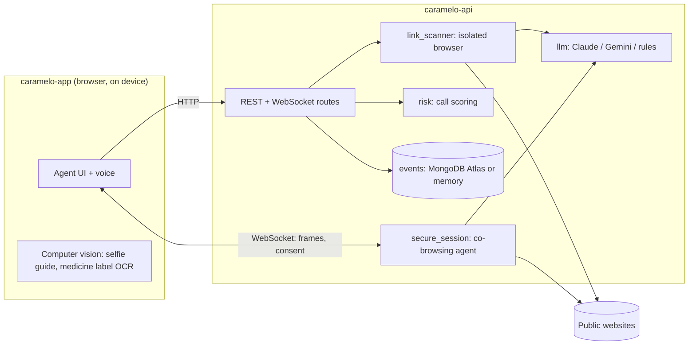

# Architecture



## Layers

| Package | Responsibility |
| --- | --- |
| `app/api` | Transport only: routes and request schemas |
| `app/services` | Business logic: link scanning, secure session, risk scoring, partner stubs |
| `app/core` | Cross-cutting clients: LLM, browser launcher |
| `app/db` | Persistence behind the `EventRepository` protocol |

## Design decisions

- **Safety in code, not in prompts.** The LLM proposes the next step; consent, credential
  handover and domain blocking are deterministic (see `SECURITY.md`).
- **Explainable risk.** Scores are weighted sums of named signals, so every result can be
  explained to the user and reviewed.
- **Pure scoring functions.** `risk.assess_call` and `link_scanner.evaluate` do no I/O and
  are unit-tested without a browser.
- **Graceful degradation.** No LLM key means rules mode; no MongoDB means in-memory events.
- **Guide mode before evasion.** Sites may refuse automated browsers (gov.br rejects any captcha
  solved in one with `ERL0000900`). The secure session never disguises its browser; it switches to
  guide mode (`app/services/guides.py`): the official site opens in the user's own browser and
  Caramelo speaks each step. The user can also ask for it at any consent or handover screen.
  The long-term path for gov.br is the Login Único integration for accredited partners.
- **User-facing copy is Brazilian Portuguese.** Code, identifiers and docs are English.

## What is simulated

`app/integrations/stubs.py` stubs GSMA Open Gateway (SIM Swap) and Open Finance Brasil,
which require commercial contracts. Stubs mirror the real response shape.

## Knowledge base (RAG)

`app/knowledge/seed.json` holds curated, sourced guidance about everyday life of older adults in
Brazil (rights, benefits, documents, scams, health). It contains no user data.

- Collection: `caramelo.knowledge_base`, one document per chunk (`topic`, `title`, `text`, `source`).
- Index: Atlas Vector Search `knowledge_vector` with auto-embedding on `text` (`voyage-4-lite`)
  and `topic` as a filter field. Atlas embeds documents and queries; the API holds no embedding model.
- Retrieval: `MongoKnowledgeRepository` (`$vectorSearch`, hits below `MIN_VECTOR_SCORE` are dropped so
  off-topic questions get no answer instead of the nearest unrelated chunk) wrapped by `FallbackKnowledgeRepository`,
  which falls back to keyword search over the same corpus when Atlas is unavailable or rate limited.
- Generation: `app/services/assistant.py` lets the model phrase an answer from the retrieved chunks
  only. Without a model, the best chunk is returned verbatim. Sources are always returned.

Stable knowledge lives here. Live or personal data (benefit status, balance, carrier signals)
comes from partner APIs in `app/integrations`, never from this collection.

Index definition:

```json
{ "fields": [
  { "type": "autoEmbed", "path": "text", "model": "voyage-4-lite", "modality": "text" },
  { "type": "filter", "path": "topic" }
] }
```
