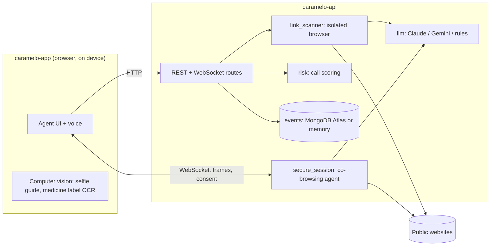

# Architecture

## Layers

| Package | Responsibility |
| --- | --- |
| `app/api` | Transport only: routes and request schemas |
| `app/services` | Business logic: link scanning, secure session, risk scoring, partner stubs |
| `app/core` | Cross-cutting clients: LLM, browser launcher |
| `app/db` | Persistence behind the `EventRepository` protocol |

## Design decisions

- **Safety in code, not in prompts.** The LLM proposes the next step; consent, credential
  handover and domain blocking are deterministic (see `SECURITY.md`).
- **Explainable risk.** Scores are weighted sums of named signals, so every result can be
  explained to the user and reviewed.
- **Pure scoring functions.** `risk.assess_call` and `link_scanner.evaluate` do no I/O and
  are unit-tested without a browser.
- **Graceful degradation.** No LLM key means rules mode; no MongoDB means in-memory events.
- **User-facing copy is Brazilian Portuguese.** Code, identifiers and docs are English.

## What is simulated

`app/integrations/stubs.py` stubs GSMA Open Gateway (SIM Swap) and Open Finance Brasil,
which require commercial contracts. Stubs mirror the real response shape.
